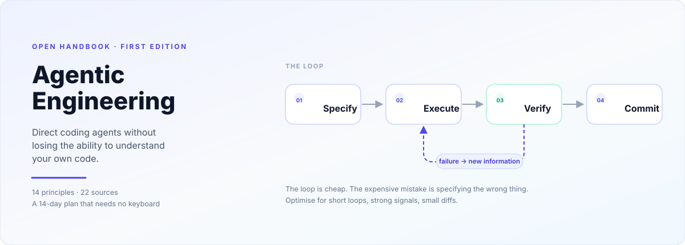
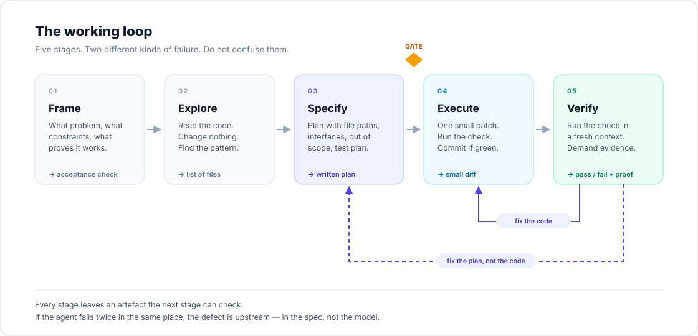

# Agentic Engineering

**A durable handbook for directing coding agents — and staying the engineer.**

[The 14 principles](#the-fourteen-principles) · [Reading canon](reading/README.md) · [14-day plan](study/two-week-plan.md) · [Exercises](exercises/README.md) · [Checklists](appendix/checklists.md) · [Question bank](study/question-bank.md)

---

## What this is

Most agentic-coding material is a tour of one tool's features. It is useful for a month and wrong by the next release.

This repository is the opposite: a small set of **mechanisms** that explain why agents succeed or fail, independent of which model or CLI you use. The tool names will change. The mechanisms will not.

It is built from 22 primary sources — Anthropic's engineering write-ups, practitioner field reports, a randomised controlled study, and the best public skill libraries — condensed into something you can actually use, with every source linked and dated.

**Who it is for:** engineers who can already write software and want to direct agents without becoming a spectator in their own codebase.

---

## Start here

| If you have… | Do this | Time |
|---|---|---|
| **Two weeks, no ability to code** | [The 14-day plan](study/two-week-plan.md) — reading, reflection and writing only. No keyboard needed. | 45–60 min/day |
| **A free weekend** | [The canon](reading/README.md), tiers 0–1, then install one skill library and use it on a real task. | ~6 h |
| **Ready to practise** | [The nine labs](exercises/README.md) — a deliberately broken repo, guided fixes, a full answer key. | 9–10 h |
| **Ten minutes** | [The fourteen principles](#the-fourteen-principles) below, then [the verification ladder](docs/04-verification.md). | 10 min |
| **A specific problem** | [Antipatterns](docs/09-antipatterns.md) — symptom → cause → fix. | 5 min |

---

## The fourteen principles

Each links to the chapter that explains the mechanism, the failure mode, and how to practise it.

| # | Principle | Chapter |
|---|---|---|
| 1 | **Specification and verification are the bottleneck now — not typing.** If your output did not rise, typing was never the constraint. | [Mental model](docs/01-mental-model.md) |
| 2 | **Context is a budget.** Every file read, log line and dead end is a purchase. Spend it on signal. | [Context](docs/03-context.md) |
| 3 | **A claim is not evidence.** An agent saying "done" costs nothing and means nothing. | [Verification](docs/04-verification.md) |
| 4 | **Plan in proportion to risk.** A one-sentence diff needs no plan; a multi-file change needs a written one. | [The loop](docs/02-the-loop.md) |
| 5 | **Small batches, reversible steps.** Long autonomous runs compound error faster than they compound output. | [The loop](docs/02-the-loop.md) |
| 6 | **Rules in the repo, gates in the tooling.** Prose is advisory; hooks and CI are deterministic. | [Environment](docs/05-environment.md) |
| 7 | **Optimise the feedback loop, not the prompt.** Fast tests and honest errors beat clever wording. | [Environment](docs/05-environment.md) |
| 8 | **Design for legibility — human and machine.** Simple, local, explicit code is agent-native code. | [Code design](docs/06-code-design.md) |
| 9 | **Parallelise work, isolate state.** Two agents in one checkout is not parallelism, it is a race condition. | [Orchestration](docs/07-orchestration.md) |
| 10 | **Separate the writer from the reviewer.** Fresh context is the cheapest objectivity you can buy. | [Orchestration](docs/07-orchestration.md) |
| 11 | **Stay the engineer.** If you cannot explain the change without the tool open, you do not own it yet. | [Judgment](docs/08-judgment.md) |
| 12 | **Measure outcomes, not activity.** Tokens and commits are vanity; cycle time and rework are signal. | [Judgment](docs/08-judgment.md) |
| 13 | **Prefer boring, stable technology.** Agents are most reliable where the ecosystem stops moving. | [Code design](docs/06-code-design.md) |
| 14 | **Know when not to delegate.** Some code is cheaper to write than to specify and verify. | [Mental model](docs/01-mental-model.md) |

---

## The shape of the work

The important detail is that there are **two** feedback loops, and they are not interchangeable. An execution error means the plan was right and the code was wrong. A specification error means the plan was wrong — and retrying the code will never fix it. Most frustration with agents is a specification error being treated as an execution error, repeatedly.

---

## Contents

### Foundations
- [01 · The mental model](docs/01-mental-model.md) — what actually changed, and what did not
- [02 · The working loop](docs/02-the-loop.md) — frame, explore, specify, execute, verify, commit
- [03 · Context](docs/03-context.md) — the resource that decides everything
- [04 · Verification](docs/04-verification.md) — the ladder from "it compiles" to "I watched it work"

### Practice
- [05 · Environment](docs/05-environment.md) — making your repo fast and legible for agents
- [06 · Code design](docs/06-code-design.md) — writing code that agents can safely change
- [07 · Orchestration](docs/07-orchestration.md) — parallel sessions, isolation, review
- [08 · Judgment](docs/08-judgment.md) — cognitive debt, measurement, and staying sharp
- [09 · Antipatterns](docs/09-antipatterns.md) — the twelve ways this goes wrong

### Reference
- [Reading canon](reading/README.md) — 22 sources, annotated, with honest reading times
- [Exercise track](exercises/README.md) — nine guided labs on a broken repo, with solutions
- [14-day plan](study/two-week-plan.md) — no-code curriculum with daily prompts
- [Question bank](study/question-bank.md) — 40 questions for spaced repetition
- [Checklists](appendix/checklists.md) — pre-flight, definition of done, repo readiness
- [Prompt patterns](appendix/prompt-patterns.md) — ten templates that survive model changes
- [Glossary](appendix/glossary.md)
- [Sources & claims ledger](SOURCES.md) — what each claim rests on, and how confident it should make you

---

## How this stays correct

Every link was resolved and every factual claim checked on **2026-10-23**. Each source in [the canon](reading/README.md) carries a **durability** rating:

| Rating | Meaning | Example |
|---|---|---|
| **Durable** | About mechanisms. Should still be true in two years. | Anthropic, *Building Effective Agents* |
| **Slow decay** | Tool-specific, but the patterns transfer. | Claude Code best practices |
| **Fast decay** | Version-pinned. Read for ideas, not instructions. | Feature walkthroughs, harness configs |

The repo deliberately contains **no** model names, benchmark tables, or version numbers in its principles. Those belong in the [sources](reading/README.md), where they can be dated and replaced.

If something here is wrong, the fix is a pull request with a source and a date — not a rewrite from memory.

---

## A note on tone

There is a lot of confident nonsense in this space: that review is obsolete, that specs are bureaucracy, that one person can now replace a team. Some of it is true for some tasks. Most of it is survivorship bias with a screenshot attached.

The stance here is deliberately conservative: **agents make competent engineers faster and incompetent ones more dangerous.** The difference is not prompt skill. It is the ability to specify, verify, and say no.

---

*Text licensed [CC BY-SA 4.0](https://creativecommons.org/licenses/by-sa/4.0/). Code samples [MIT](LICENSE).*
*Ideas belong to the people in [SOURCES.md](SOURCES.md); the synthesis and any errors are this repository's.*

