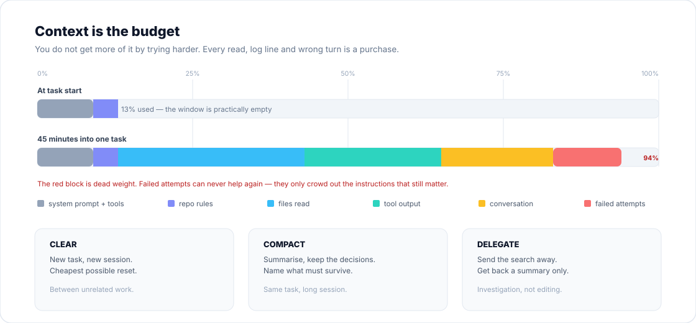

# 03 · Context

> **Principle 2** — Context is a budget. Spend it on signal.



---

## The definition worth memorising

Anthropic's formulation is the best one available:

> **"The smallest possible set of high-signal tokens that maximize the likelihood of some desired outcome."**

Every word of that matters. *Smallest* — because space is finite. *High-signal* — because filler is worse than empty. *Maximises likelihood* — because the goal is not completeness, it is correctness.

Notice what is absent: "include everything relevant". That instinct is the single most common cause of agent failure.

---

## What is in the window before you type anything

A typical session starts already partly spent:

| Loaded at start | Roughly |
|---|---|
| System prompt + tool definitions | 10–15% |
| Repo rules file(s) | 1–5% |
| Any auto-attached files or diagnostics | varies |

That is your fixed overhead. Everything after is discretionary, and it does not shrink when you ignore it.

---

## Quality degrades before the window is full

This is the part people underestimate. The failure is not a hard stop at 100% — it is a gradual decay that starts well before the limit.

Symptoms, roughly in the order they appear:

1. It stops following a rule you gave it early on.
2. It re-suggests an approach you already rejected.
3. It becomes vague where it was specific ("and so on", "similar handling").
4. It starts editing files you did not mention.
5. It loops.

By the time you notice (4), you have usually been losing quality for a while. The intervention is not a better prompt. It is a smaller context.

> [!WARNING]
> **The correction spiral.** Two failed corrections pollute the window with approaches that did not work. The model can see them, and they influence what it tries next. A clean session with a sharper prompt beats a long session full of scar tissue. This is why the two-correction rule exists.

---

## Four levers

| Lever | What it does | When |
|---|---|---|
| **Clear** | Reset to zero | New, unrelated task. Cheapest and most underused. |
| **Compact** | Summarise, keep decisions | Same task, long session. Name what must survive. |
| **Delegate** | Move work to a separate context | Investigation, searching, reviewing |
| **Externalise** | Move facts into files | Anything that must persist across sessions |

### Clear

The default between tasks. Not a failure, not an admission — just hygiene. If you find yourself pasting the same background twice, that background belongs in a file (see *Externalise*).

### Compact

Compaction is lossy in a specific way: it tends to preserve *what happened* and lose *what was decided and why*. If you use it, give it explicit instructions:

```
/compact Preserve: the list of modified files, the public interfaces we
settled on, the two approaches we rejected and why, and the test command.
```

### Delegate

An agent reading 40 files to answer one question spends 40 files' worth of window on an answer you needed in one paragraph. A subagent gets its own window and returns only the conclusion.

Use it for: "how does auth work here", "where is X used", "review this diff", "find the pattern we use for Y". Do **not** use it for the work you are about to edit — that context is the point.

### Externalise

Anything the next session needs belongs in a file, not in a chat you will not resume.

That is what the rules file is: **a cache, not a diary.** It is loaded every single session, so every line has a permanent tax.

---

## Writing a rules file that gets followed

The counter-intuitive property: **a longer rules file is followed less**, because important instructions get diluted. If the agent keeps ignoring a rule, the usual cause is that the file is too long, not that the rule is too weak.

Include only what the agent cannot infer:

| Include | Exclude |
|---|---|
| Build / test / lint commands it cannot guess | Anything discoverable by reading the code |
| Style rules that differ from language defaults | Standard conventions the model already knows |
| Repo etiquette: branch names, commit format | Tutorials and explanations |
| Architectural invariants and their reasons | File-by-file maps of the codebase |
| Environment quirks: required vars, ports, seeds | Self-evident advice ("write clean code") |
| Known gotchas that have bitten people | Anything that changes weekly |

Test each line:

> *Would removing this cause a mistake?*

If not, delete it. Then delete another 20% and see if anything breaks. It usually does not.

If a rule must hold **every time**, prose is the wrong tool. Move it into a hook, a lint rule, or CI. Instructions are advisory; gates are deterministic. Chapter [05](05-environment.md) covers this.

> [!NOTE]
> Tool-specific names vary — `CLAUDE.md`, `AGENTS.md`, `.cursor/rules`, and so on. The mechanism is identical: a small file loaded every session. Treat it as code: review it, prune it, version it, and be suspicious of it when it grows.

---

## Push, don't pull

The instinct is to preload: paste the architecture doc, the schema, five example files. This feels thorough and is usually counterproductive — most of it will be irrelevant, and the relevant part is now buried.

Prefer **just-in-time retrieval**: let the agent fetch what it needs, when it needs it, guided by a precise pointer.

| Instead of | Say |
|---|---|
| Pasting 800 lines of an example | "Follow the pattern in `src/widgets/HotDogWidget.tsx`" |
| Explaining the database schema | "The schema is in `db/schema.sql`; read the `orders` table" |
| Describing a bug from memory | "Here is the failing test output" (paste it) |
| Describing a UI | Paste the screenshot, or point at the design file |

Pointers beat payloads. A file path costs 5 tokens and lets the agent decide what matters.

---

## The three failures to recognise

| Failure | Looks like | Fix |
|---|---|---|
| **Kitchen sink** | One session, three unrelated tasks, mounting confusion | Clear between tasks |
| **Correction spiral** | "No, not like that. No, the other thing." ×5 | Clear after two; rewrite the prompt with what you learned |
| **Infinite exploration** | "Investigate the codebase" → reads 200 files | Scope the question, or delegate it |

All three are the same underlying error: treating a finite resource as if it were free.

---

## Practice

1. Estimate your fixed overhead: how much of the window is spent before your first message? (Most tools expose a context/usage view.)
2. Open your rules file and delete every line that fails the *"would removing this cause a mistake?"* test. Count how many survive. If more than ~40 lines survived, you are probably describing the codebase rather than constraining behaviour.
3. Recall your last long session. Identify the exact message where quality began to drop. What had just entered the context?

---

**Next:** [04 · Verification](04-verification.md) — the ladder, and why "it compiles" is not a rung.
