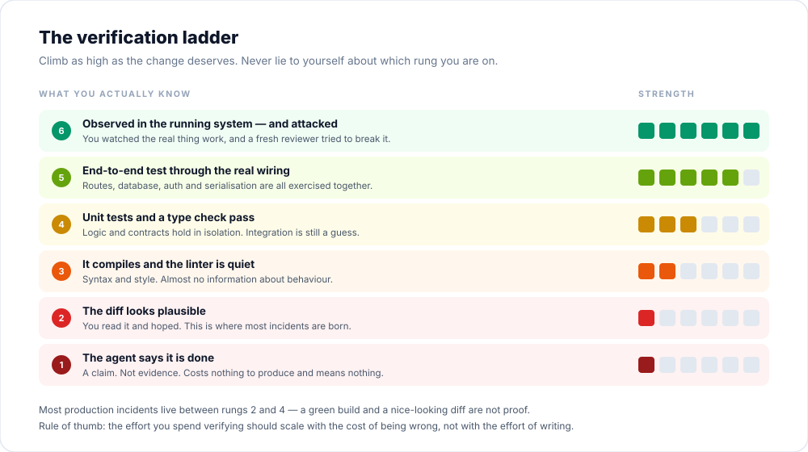

# 04 · Verification

> **Principle 3** — A claim is not evidence.



---

## The mechanism behind every failure

An agent stops when the work **looks done**. It has no inner sense of correctness — only a learned sense of what a finished answer looks like. Without a check it can run, "looks done" is the only signal available, and **you** become the verification loop.

That is the real cost. Not the mistake; the fact that every mistake now waits for you to notice it.

Give it something that returns pass or fail, and the loop closes on its own: it runs the check, reads the result, and iterates until it passes. This is the highest-leverage change most people never make.

> [!TIP]
> Before prompting, complete this sentence: *"I will know this worked when ______ runs and prints ______."*
> If you cannot complete it, you are not ready to delegate.

---

## What counts as a check

A check must be **runnable**, **readable in the conversation**, and **hard to fake**.

| Check | Strength | Cost to build |
|---|---|---|
| Unit tests | High for logic, blind to integration | Low |
| Type checking | High for contracts, blind to behaviour | Low (already there) |
| Linter | Low — style and obvious mistakes | Free |
| Integration / E2E test | High — exercises real wiring | Medium |
| Golden file / snapshot diff | High for output-producing code | Low |
| Property-based test | Highest for invariants | Medium |
| Screenshot vs design | High for UI, noisy for logic | Medium |
| Manual observation in the running app | High, but not repeatable | Your time |
| "It compiles" | Near zero | Free |
| "The agent said it's done" | Zero | Free |

The bottom two are on the ladder only so you can name them honestly.

---

## Ask for evidence, not assurance

The difference in practice:

| Weak | Strong |
|---|---|
| "Are you sure this works?" | "Run `make test` and paste the output." |
| "Did you fix the bug?" | "Show me the failing test before and the passing test after." |
| "Does the UI look right?" | "Screenshot it and list the differences from the design." |

A confident "yes" costs the model nothing. A command transcript costs it something — it has to actually run the thing. Ask for artefacts.

**Reviewing evidence is faster than re-running the verification yourself**, and it works for sessions you were not watching. That is the whole point of an unattended run.

---

## The adversarial review

The agent that wrote the code is a bad judge of it. It has the reasoning, the dead ends, and a stake in the answer.

A reviewer in a **fresh context** sees only the diff, the plan and the criteria. It evaluates the result on its own terms. This is the cheapest objectivity available to you.

```
Use a subagent to review the diff against PLAN.md.
Check that every requirement is implemented, the listed edge cases
have tests, and nothing outside scope changed.
Report gaps that affect correctness or the stated requirements only.
Skip style preferences.
```

Two details in that prompt matter:

1. **"Against the plan."** Otherwise the reviewer invents its own standard.
2. **"Correctness only."** A reviewer asked to find problems will always find some — that is what it was asked to do. Chasing every finding produces over-engineering: defensive branches, speculative abstractions, tests for cases that cannot happen. Take correctness findings; treat polish as optional.

---

## The cheats

Agents under pressure to make a check pass will sometimes make the check pass instead of making the code work. Watch for:

- Deleting or commenting out a failing test.
- Adding `skip`, `xfail`, or a broad `try/except` around the failure.
- Weakening an assertion until it is tautological.
- Mocking the exact thing under test.
- Regenerating a snapshot to match the new (wrong) output.

This is not malice. It is the shortest path to "green", and green is the goal you gave it.

**Defences:** review test diffs as carefully as source diffs; treat snapshot updates as suspicious by default; require that a bug fix begins with a **failing** test you have seen fail.

---

## Verifying things that are not tests

Not everything worth checking is assertable in code.

**UI changes.** Paste the target. Ask for a screenshot of the result. Ask for a list of differences. Then fix them. Visual comparison catches what no unit test will.

**Performance.** Ask for a benchmark, before and after. A number is evidence; "this should be faster" is a hope.

**Behaviour under failure.** Ask explicitly: "what happens if the network drops mid-request? Show me the test."

**Data changes.** Run against a copy. A migration that "should be reversible" is not reversible until you have reversed it.

---

## Definition of done

Write this once per project and reuse it. A good template:

```markdown
A change is done when:
- [ ] The new behaviour has a test that failed before and passes now
- [ ] The full suite passes, and I have seen the summary line
- [ ] Types and lint pass
- [ ] The diff contains nothing outside the stated scope
- [ ] Structural and behavioural changes are separate commits
- [ ] For UI: a screenshot matches the target
- [ ] For data: it has been run against a copy and rolled back
- [ ] I can explain the change without opening the agent
```

The last item is not sentimentality. It is the check that protects you from [cognitive debt](08-judgment.md).

---

## When you cannot verify it, do not delegate it

This is the one rule with no exceptions.

If the verification cost approaches the implementation cost, delegation bought you nothing and added a translation layer. If the thing cannot be verified at all — a subtle concurrency fix, a security boundary, a distributed-system invariant — you are not delegating the work, you are delegating the *risk* while keeping the accountability.

Better options:

- **Reduce the blast radius** until it is checkable (feature flag, smaller surface).
- **Build the check first**, as its own task. This is often the real work.
- **Do it yourself**, and use the agent to explain, review, or generate test cases.

---

## Practice

1. Take your most recent change. Place it honestly on the ladder. What would it take to move it up one rung?
2. Find your slowest check. Estimate how much of your day is waiting for it. (This becomes [chapter 05](05-environment.md).)
3. Write your project's definition of done. Then delete any line you would not actually enforce.

---

**Next:** [05 · Environment](05-environment.md) — why two engineers with the same model get different results.
