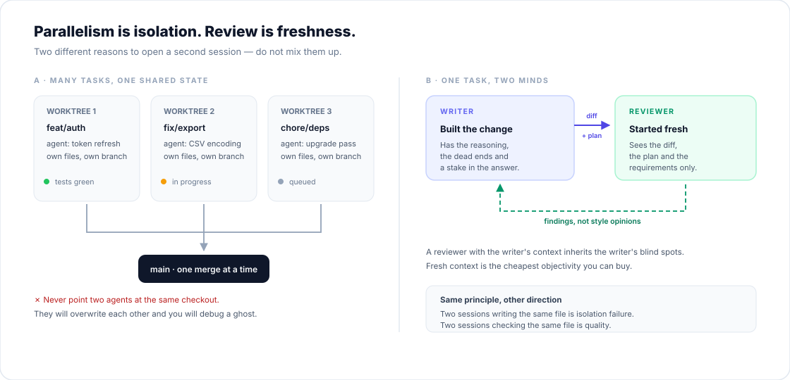

# 07 · Orchestration

> **Principles 9 and 10** — Parallelise work, isolate state. Separate the writer from the reviewer.



---

## Two different reasons to open a second session

These are constantly confused, and the confusion produces bad architecture.

| | **Parallelism** | **Independence** |
|---|---|---|
| Goal | More throughput | Better judgement |
| Requires | Isolated state | Fresh context |
| Risk | Merge conflicts, shared resources | Cost, duplicated effort |
| Example | Three features in three worktrees | A reviewer who did not write the code |

Parallelism is a scheduling problem. Independence is an epistemology problem. Neither is "multi-agent architecture" in the marketing sense.

---

## Parallelism: the constraint is shared mutable state

One agent is not fast. Five agents are fast *if* they do not collide.

Collisions happen at every layer, not just the filesystem:

| Layer | Collision | Fix |
|---|---|---|
| Files | Two agents edit the same file | One worktree per task |
| Git | Two agents on the same branch | One branch per worktree |
| Database | Tests mutate shared rows | Per-worker database, or transactions |
| Ports | Two dev servers on 3000 | Dynamic ports |
| Caches | One agent invalidates another's build | Per-worktree cache dirs |
| External APIs | Rate limits, shared sandbox accounts | Separate credentials, or mock |

The filesystem fix is trivial:

```bash
git worktree add ../feat-auth -b feat/auth
git worktree add ../fix-export -b fix/export
# then run one agent session in each directory
```

Containers solve the rest, at the cost of setup. The right answer is usually: worktrees for files and git, plus per-worktree database names and ports.

> [!WARNING]
> **Never point two agents at the same checkout.** They will overwrite each other's uncommitted work, and the resulting bug will look like a model failure when it is a concurrency failure.

### What parallelises well

- Independent features touching different modules.
- Migrations and mechanical refactors across many files.
- Test generation for existing code.
- Investigation / research questions.
- Anything where each unit has its own verification.

### What does not

- Two halves of the same interface.
- A change that requires a global design decision.
- Anything where agent B needs to see agent A's in-progress work.
- Debugging one incident (the signal is shared and sparse).

If the tasks must agree on a design, do the design **first**, alone, and then parallelise the implementation against the written plan. That is the whole trick: parallel execution of a serial decision.

### Fan-out for migrations

The pattern that reliably works:

1. Have one session produce a **list** of files to change and the exact transformation.
2. Run the transformation on **three** files manually. Fix the prompt based on what breaks.
3. Loop over the rest with a script, one fresh invocation per file, with the tools pre-approved and a clear `OK`/`FAIL` output.
4. Verify the aggregate: full suite, diff review, spot-check a sample.

Step 2 is the one people skip, and it is the one that determines whether the loop produces 200 good diffs or 200 confident ones.

---

## Independence: the reviewer must not share the writer's context

The agent that wrote the code is biased toward its own reasoning. It remembers why it chose the approach, which makes it unlikely to question whether the approach was right.

A reviewer with a **fresh context** sees:

- the diff,
- the plan or requirements,
- nothing else.

That is not a limitation; it is the mechanism. It evaluates the artefact rather than the story.

```
You are reviewing a change you did not write.
The plan is in PLAN.md. The diff is in the working tree.
Report only gaps that affect correctness or a stated requirement.
For each: file, line, what breaks, and how to reproduce.
Do not report style preferences, naming, or speculative future needs.
```

### The over-engineering trap

A reviewer asked to find problems will find problems. That is what you asked for.

Chasing every finding produces: extra abstraction layers, defensive code for impossible states, and tests for cases that cannot occur. The code gets worse while the review gets "better".

Tell the reviewer what counts as a finding, and treat the rest as optional. **Correctness and stated requirements only.**

### Other useful separations

| Writer | Reviewer | Catches |
|---|---|---|
| Implementation agent | Fresh review agent | Missed requirements, edge cases |
| Test-writer | Implementation agent | Tests that encode assumptions rather than behaviour |
| Implementation agent | Same agent, next day | Tunnel vision, after a context clear |
| You | Agent | Your own blind spots — the agent reviews *your* diff |

The last row is underrated. Use the agent to review human code too; it is often the highest-value use of the tool.

---

## Why not "a team of agents"?

The tempting architecture — an orchestrator that splits a task into subtasks and merges the results — fails for a specific, structural reason:

> **Subtasks share context, and actions carry implicit decisions.**

If two subagents are told "build the background" and "build the bird", each makes hundreds of small decisions the other cannot see. The results are individually reasonable and jointly incoherent. The orchestrator then has to reconcile two sets of invisible assumptions, which is harder than doing the work once.

This is why the strongest practitioner guidance is: **share full context, or do not split the task.** Subagents are excellent for *independent* work (search, review, isolated files). They are poor for *coupled* work (one feature, one interface, one design).

The rule of thumb:

> Split when the pieces can be verified independently.
> Do not split when they must agree.

---

## Coordination has a cost

Every additional session costs you something:

- **Attention**: you are now context-switching between diffs.
- **Integration**: more branches, more merges, more conflicts.
- **Verification**: more surface area to check, and you are the only reviewer.
- **Token cost**: five agents reading the same codebase five times.

Parallelism pays when tasks are big enough to amortise that cost and independent enough to avoid collisions. For a 20-line change, it is pure overhead.

---

## A practical setup

1. **One worktree per task**, named for the branch.
2. **One rules file** in the repo; per-worktree overrides only when necessary.
3. **A shared `make verify`** that any session can run.
4. **A review session** that only sees the diff and the plan.
5. **A merge queue of one**: you merge, one at a time, after the check passes.
6. **A kill switch**: know how to stop everything and how to throw a worktree away.

That is enough for most individuals and small teams. More machinery usually means you are optimising coordination instead of shipping.

---

## Practice

1. Count how many agent sessions you ran last week that touched the same repository at the same time. Were they isolated?
2. Take a task you would normally do serially. Write the plan, then split it into pieces with **independent verification**. Where does the split feel wrong? That is the coupling.
3. Run one review with a fresh session, giving it only the diff and the plan. Compare its findings with your own review. Note which of you was better at what.

---

**Next:** [08 · Judgment](08-judgment.md) — the part that does not automate.
