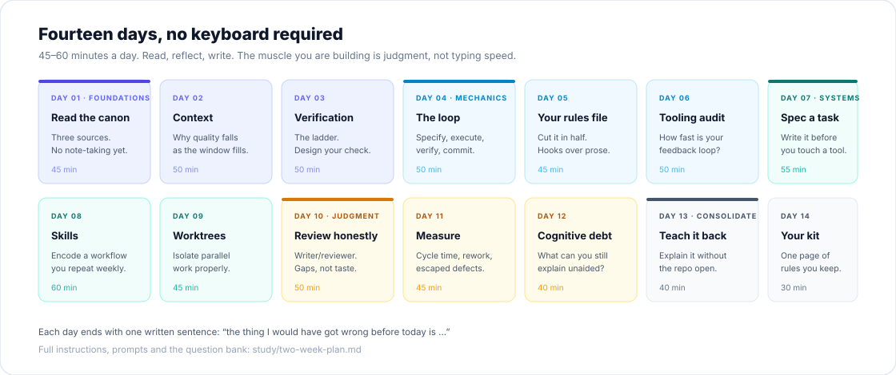

# The fourteen-day plan

**For the two weeks when you cannot code.**

You are away from a keyboard. That is not a disadvantage for this material — almost everything that separates a good agentic engineer from a bad one happens *before* typing and *after* generation. Both of those are thinking activities.

So this plan has no installation steps, no terminal exercises, and no "try it now" prompts. It has reading, reflection, and writing. By day 14 you will have a rules file, a spec, a verification plan, a measurement baseline, and a one-page operating kit — all ready to use the day you are back.

---

## Ground rules

1. **45–60 minutes a day.** Set a timer. Stop when it rings.
2. **One page of notes per day, by hand if possible.** Handwriting forces compression.
3. **End every day with one sentence**, in this exact form: *"The thing I would have got wrong before today is …"*
4. **Do not optimise the plan.** If a day takes 20 minutes, take the win and stop.
5. **No tool shopping.** You are not allowed to evaluate agents, compare models, or read release notes. That is the fastest way to learn nothing.

Everything is readable on a phone. The long pieces are marked so you can split them.

---

## Week one — foundations

### Day 1 · Read the canon (45 min)

**Read:** [Building Effective Agents](https://www.anthropic.com/engineering/building-effective-agents) (20 min) and the first half of [Agentic Coding Recommendations](https://lucumr.pocoo.org/2025/6/12/agentic-coding/) (7 min).

**Think:** Which of Anthropic's patterns describes what you already do? Which describes what you *should* be doing?

**Write:** Two lists — "workflows I already use" and "agents I actually need". Be strict about the second. Most entries will not survive.

---

### Day 2 · Context (50 min)

**Read:** [Effective Context Engineering](https://www.anthropic.com/engineering/effective-context-engineering-for-ai-agents) (18 min), then [chapter 03](../docs/03-context.md) (15 min).

**Think:** Recall your last long agent session. Where exactly did quality start to slip — what had just entered the context?

**Write:** Your personal "context rules" — three rules, in imperative form. Example: *"Clear after two failed corrections, no exceptions."*

---

### Day 3 · Verification (50 min)

**Read:** [The verification ladder](../docs/04-verification.md) (15 min), then the "Give Claude a way to verify its work" and "Avoid common failure patterns" sections of [Best Practices](https://code.claude.com/docs/en/best-practices) (20 min).

**Think:** Take your last five merged changes. Place each honestly on the ladder.

**Write:** A definition of done for your main project. Every line must be something you would actually enforce.

---

### Day 4 · The loop (50 min)

**Read:** [Augmented Coding](https://tidyfirst.substack.com/p/augmented-coding-beyond-the-vibes) by Kent Beck (14 min), then [chapter 02](../docs/02-the-loop.md) (15 min).

**Think:** Beck's two warning signs are *loops* and *unrequested functionality*. Which one do you tolerate more?

**Write:** The six stages of the loop, from memory, with the artefact each one produces. Check yourself afterwards. The stages you forget are the ones you skip.

---

### Day 5 · Your rules file (45 min)

**Read:** The "rules file" section of [chapter 03](../docs/03-context.md) and the CLAUDE.md section of [Best Practices](https://code.claude.com/docs/en/best-practices) (15 min).

**Think:** What do you tell a new contributor in their first week? That is your draft.

**Write:** A complete rules file for your main repo, **from memory only**, maximum 40 lines. Then mark which lines you are unsure about — those are the ones to verify when you are back. If you cannot fill 10 lines from memory, that is a finding.

---

### Day 6 · Tooling audit (50 min)

**Read:** [chapter 05](../docs/05-environment.md) (20 min), then the "Tools, Tools, Tools" section of [Armin's post](https://lucumr.pocoo.org/2025/6/12/agentic-coding/) (10 min).

**Think:** You cannot run anything, so estimate: how long does your test suite take? How long from edit to feedback? How long from clone to green?

**Write:** Your three loop times (estimated), the single slowest step, and one fix you could ship in an hour. Add a note on how you will measure them properly on day 15.

---

### Day 7 · Spec a real task (55 min)

**Read:** [chapter 02](../docs/02-the-loop.md) again, specifically "What a usable spec contains" (10 min).

**Think:** Pick a real backlog item you will do when you return. Not a toy — something that has been sitting there.

**Write:** A full spec: goal, files and interfaces, out of scope, verification. Then answer: **which section was hardest to fill in?** That is the part of the problem you do not yet understand.

---

## Week two — mechanics, systems, judgment

### Day 8 · Skills (60 min)

**Read:** [Superpowers](https://github.com/obra/superpowers) README (10 min) and [Agent Skills](https://github.com/addyosmani/agent-skills) README (13 min).

**Think:** What do you repeat every week that a written procedure would improve? Code review? Release notes? Investigating a bug class?

**Write:** The outline of one skill: when it triggers, what it reads, the steps, and what "done" means. Do not write the file yet — outline it on paper.

---

### Day 9 · Worktrees and isolation (45 min)

**Read:** [chapter 07](../docs/07-orchestration.md) (20 min) and the Cognition essay [Don't Build Multi-Agent Systems](https://cognition.ai/blog/dont-build-multi-agents) (11 min).

**Think:** Which parts of your current work are genuinely independent, and which only look independent?

**Write:** A plan for running two tasks in parallel on your main repo: worktree names, database strategy, port strategy, merge order.

---

### Day 10 · Review honestly (50 min)

**Read:** [Vibe Engineering](https://simonwillison.net/2025/Oct/7/vibe-engineering/) by Simon Willison (10 min), then the review sections of [chapter 04](../docs/04-verification.md) and [chapter 07](../docs/07-orchestration.md) (20 min).

**Think:** Recall the last bug that reached production. Would a fresh-context reviewer have caught it? What would it have needed to know?

**Write:** A review prompt template. Include: what to check, against what standard, and what does *not* count as a finding.

---

### Day 11 · Measure (45 min)

**Read:** [METR 2025](https://metr.org/blog/2025-07-10-early-2025-ai-experienced-os-dev-study/) (20 min) and [the 2026 update](https://metr.org/blog/2026-02-24-uplift-update/) (11 min).

**Think:** The 2025 developers were confidently wrong about their own speed. What evidence would convince *you* that you had improved?

**Write:** Two metrics, their current (estimated) values, and how you will collect them for four weeks. No more than two.

---

### Day 12 · Cognitive debt (40 min)

**Read:** [chapter 08](../docs/08-judgment.md) (20 min).

**Think:** Answer the ownership audit from memory: five significant changes from the last quarter. Can you explain each without the tool? Score 1–5.

**Write:** The one change you are least able to explain, and a concrete plan to fix that — read the module, write a paragraph explaining it, or pair with someone.

---

### Day 13 · Consolidate (40 min)

**Read:** Nothing new. This is a retrieval day.

**Write:** The fourteen principles from memory, one line each. Then open the [README](../README.md) and compare. Your score is not the point; the gaps are. Those are what to review on day 14.

---

### Day 14 · Your kit (30 min)

**Write one page.** This is the artefact you keep. It should contain:

- Your definition of done.
- Your two metrics.
- Your rules-file draft.
- Your spec template.
- Your review prompt.
- The one antipattern you are most likely to fall into, and the tripwire you will use.

Keep it somewhere you will see it. A page you never open is a page you did not write.

---

## Day 15 · Re-entry (the first three hours back)

The failure mode after a two-week break is to immediately start prompting. Do not.

| Order | Action | Time |
|---|---|---|
| 1 | Verify the rules file you wrote from memory. Correct it against reality. | 30 min |
| 2 | Measure the three loop times properly. Write them down. | 20 min |
| 3 | Pick the slowest and fix it, or schedule it. | 60 min |
| 4 | Execute the spec from Day 7 — with the verification section as your definition of done. | 60 min |
| 5 | Review your own diff as if someone else wrote it. Note what you missed. | 20 min |

That last step is the whole method in miniature: **produce, then check with fresh eyes.**

---

## Progress

Tick these off. The point is not completion; it is noticing which day you skipped.

| Day | Topic | Done | One-sentence takeaway |
|---|---|---|---|
| 01 | The canon | ☐ | |
| 02 | Context | ☐ | |
| 03 | Verification | ☐ | |
| 04 | The loop | ☐ | |
| 05 | Rules file | ☐ | |
| 06 | Tooling audit | ☐ | |
| 07 | Spec | ☐ | |
| 08 | Skills | ☐ | |
| 09 | Isolation | ☐ | |
| 10 | Review | ☐ | |
| 11 | Measurement | ☐ | |
| 12 | Cognitive debt | ☐ | |
| 13 | Recall | ☐ | |
| 14 | Your kit | ☐ | |

---

**Next:** [Question bank](question-bank.md) — 40 questions for spaced repetition, usable without the repo open.
